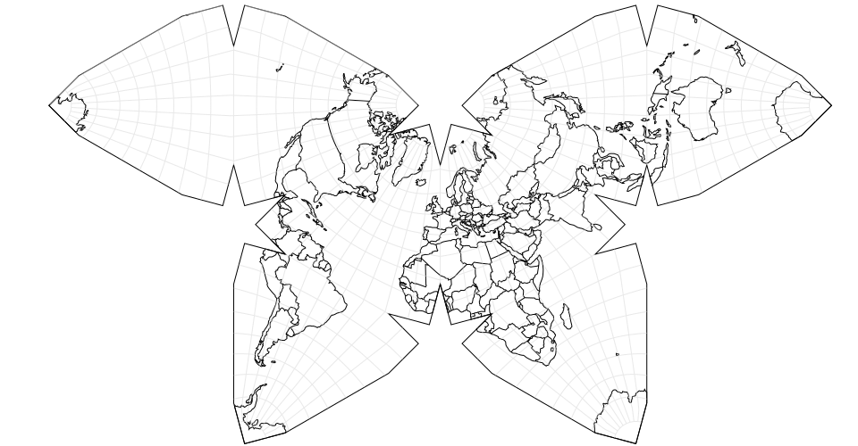

# ipyd3geo

[![pypi-badge]][pypi] [![lite-badge]][lite] [![docs-badge]][docs]

[pypi-badge]: https://img.shields.io/pypi/v/ipyd3geo
[pypi]: https://pypi.org/project/ipyd3geo/
[lite-badge]: https://jupyterlite.readthedocs.io/en/latest/_static/badge.svg
[lite]: https://ipyd3geo.readthedocs.io/en/latest/lite/lab/index.html?path=example.ipynb
[docs-badge]: https://readthedocs.org/projects/ipyd3geo/badge/?version=latest
[docs]: https://ipyd3geo.readthedocs.io

A Jupyter widget for D3-based geospatial visualization.

It is designed to work similarly to other map renderer widgets, but uses D3-Geo as its renderer.

Using D3-Geo over other map renderers has a number of key benefits:

- Renders directly to an SVG. This package acts as a bridge between Jupyter-based geospatial tools, and cartography in design software.
- Maps can be arbitrarily styled with CSS or D3
- Native vector output means no pixelation, so rendered maps are infinitely scalable.
- Native best in class projection support. There are few if any conventionally defined projections that D3-Geo does not support (including certain very obscure ones)

However, there are a few tradeoffs:

- Due to its lack of virtualization, it is far less performant with large datasets than alternatives.
- It is intentionally client-side only, so it does not have any tiling server functionality

</br></br>

> [!WARNING]
> For now this project is experimental. We cannot guarantee further development or ongoing maintenance.
>
> If you or your organization are interested in supporting this project's development, either financially or in kind, please email Benny@BennySzeghy.com

## Installation

```sh
pip install ipyd3geo
```

or

```sh
uv add ipyd3geo
```

## Development

```sh
uv sync
pnpm install ## No build step is actually needed yet. This will be added in the future
uv run pre-commit install ## Run ruff and prettier automatically on every commit
uv run pre-commit run --all-files ## Run the linters manually
```

See [examples/example.ipynb](https://github.com/geojupyter/prototype-ipyd3geo/blob/main/examples/example.ipynb) for usage.
